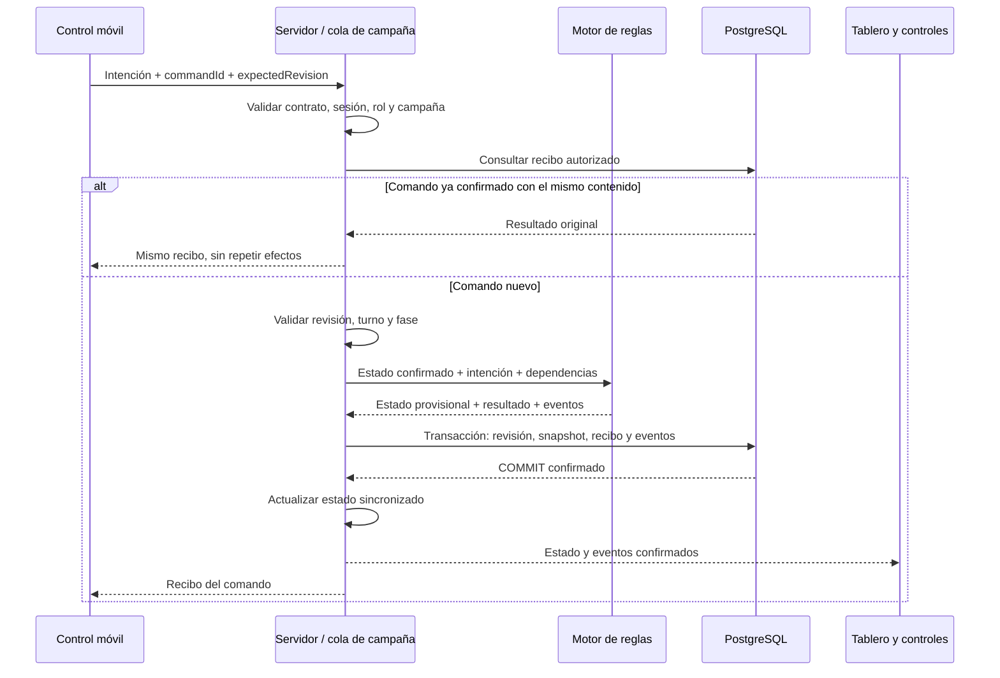

# Estructura arquitectónica

Fecha: 16 de octubre de 2026. Estado: **arquitectura aplicada a la demo**. Las funciones futuras se identifican como objetivo; consultar [estado real](../README.md) y [contratos implementados](demo.md).

Esta guía desarrolla la organización de la [especificación técnica](../rpg-cooperativo-especificacion-tecnica.md). Las reglas de juego pertenecen al [reglamento](../rpg-cooperativo-reglas-v01.md) y el alcance inicial al [brief](../rpg-cooperativo-brief-mvp.md).

## 1. Principios

1. **Una autoridad por campaña.** El servidor decide; los clientes envían intenciones y representan resultados confirmados.
2. **Reglas independientes.** El motor puede ejecutarse y probarse sin navegador, red ni base de datos.
3. **Persistencia desde el primer flujo.** Un cambio de juego confirmado debe sobrevivir al reinicio del backend.
4. **Contenido separado.** Estadísticas provisionales, mapas y animaciones no se incrustan en reglas ni componentes.
5. **Límites verificables.** Cada módulo tiene responsabilidad e importaciones permitidas; se evitan ciclos.
6. **Optimización medida.** Primero un flujo correcto para un tablero y cuatro controles; después ajustar los costos observados.

La referencia sigue siendo TypeScript, React, Phaser, Node.js, Colyseus y PostgreSQL. Las líneas de versión están en la especificación; los parches están fijados en el lockfile y fueron usados en las comprobaciones del registro de estado.

## 2. Estructura actual

Las rutas siguientes existen. Crear nuevas capas solo cuando una responsabilidad lo requiera.

```text
/
├── apps/
│   ├── web/src/
│   │   ├── main.tsx          # Composición y navegación
│   │   ├── features/         # Inicio, lobby, control, mesa, recuperación
│   │   ├── board/            # Escena Phaser
│   │   ├── connection/       # HTTP, sala y reintentos
│   │   └── ui/               # Salud, configuración y componentes comunes
│   └── server/
│       ├── src/
│       │   ├── index.ts      # Arranque, HTTP y transporte
│       │   ├── rooms/        # Presencia y proyección
│       │   ├── application/  # Casos de uso
│       │   └── persistence/  # Transacciones, esquema y migrador
│       ├── migrations/
│       └── tests/
├── packages/{core,protocol,content}/src/
├── assets/
│   ├── paladin/generated/
│   ├── guerrero/generated/
│   ├── mago/generated/
│   ├── arquera/generated/
│   ├── mapas/generated/
│   ├── maestro/
│   ├── dados/generated/
│   ├── fuentes/
│   └── manifest.json
├── tests/e2e/
├── infra/
├── scripts/
└── docs/decisiones/
```

Los tests unitarios se colocan junto al módulo que verifican; los de integración del servidor, dentro de `apps/server`. `tests/e2e` concentra los recorridos que necesitan ambas aplicaciones.

Los originales están centralizados por categoría en assets, junto a su inventario; generated contiene derivados reproducibles. La migración conserva los archivos fuente y sus nombres. El stub src/index.ts se retiró al crear las aplicaciones.

Las [recetas de actores](../packages/content/actor-recipes.json) relacionan cada clase o tipo de enemigo con carpeta, retrato, tamaño visual y clips; scripts y tablero las consumen. El contenido exclusivo del servidor define estadísticas de clase, plantillas de enemigo y posiciones iniciales en `prototype.ts`. Una aparición de enemigo tiene ID propio y `archetypeId` para reutilizar la misma receta. Agregar una clase requiere también validar su contrato, retrato y reserva; agregar un enemigo con arte requiere publicar sus derivados en la imagen web.

## 3. Responsabilidades e importaciones

En esta tabla, una importación entre paquetes siempre pasa por su API pública. Las dependencias externas se declaran en el paquete que las utiliza.

| Módulo | Responsabilidad | Dependencias internas permitidas |
| --- | --- | --- |
| `core` | Estado de dominio, invariantes y resolución determinista con aleatoriedad inyectada. | Ningún otro paquete del workspace. |
| `protocol` | Validar contratos de entrada/salida y describir vistas públicas. | Ningún otro paquete del workspace. |
| `content` | Definiciones, políticas del preset, validación y versiones de contenido. | Ningún otro paquete del workspace. |
| `server` | Autorización, casos de uso, salas y guardado. | `core`, `protocol`, `content`. |
| `web` | Interfaces, transporte cliente y representación. | `protocol` y exportaciones explícitamente públicas de `content`. |

`core` define las estructuras mínimas que necesita para resolver el juego. Los adaptadores del servidor convierten mensajes validados y definiciones de contenido a esas estructuras. `protocol` no importa el estado interno completo para construir una respuesta. Una representación pública puede tener menos campos y una forma diferente al dominio; la conversión debe ser explícita.

El paquete `content` separa exportaciones públicas de contenido exclusivo del servidor. El frontend recibe solo definiciones visuales o información ya revelada; no importa tablas secretas, resultados futuros ni contenido del servidor mediante un índice común.

Ejemplos de dependencias prohibidas: `core → React`, `protocol → pg`, `web → server`, `web → core` para resolver acciones autoritativas, y `content → Phaser`. Los paquetes no acceden a rutas internas de otros paquetes con importaciones relativas que atraviesen su límite.

El workspace declara sus paquetes y un único lockfile. Para dependencias locales usa `workspace:*`, que obliga a resolver contra el workspace según la [documentación de pnpm](https://pnpm.io/workspaces). La versión de pnpm y los scripts están en package.json.

Las instalaciones `node_modules` de la raíz y de cada paquete quedan fuera de Git. El lockfile es la fuente reproducible de dependencias; `.gitignore` usa una regla recursiva para evitar versionar instalaciones anidadas.

## 4. Recorrido de una operación



Los errores anteriores al commit no publican una operación como exitosa. El estado provisional no debe mutar objetos que Colyseus ya esté sincronizando. La sincronización de Colyseus parte de cambios del servidor y puede agrupar cambios de propiedades; los eventos explícitos del proyecto preservan el resultado de cada acción. Ver [sincronización oficial](https://docs.colyseus.io/state).

En la demo, el bloqueo de fila PostgreSQL serializa las operaciones de campaña, incluidos enemigos y creación de slots. Evitar escrituras paralelas desde rutas HTTP, callbacks de desconexión o temporizadores que eludan esa coordinación.

## 5. Estado, identidades y versiones

| Representación | Dueño | Qué contiene |
| --- | --- | --- |
| Dominio | `core` | Datos necesarios para decidir reglas e invariantes. |
| Snapshot persistente | `server/persistence` | Datos serializables y versiones necesarias para continuar. |
| Vistas de red | `server/rooms` y `protocol` | Estado autorizado para tablero o controlador. |
| Presentación local | `web` | Animaciones, paneles abiertos, transiciones y selección local. |

Mantener adaptadores explícitos. Una clase de Colyseus no es el formato de guardado y un componente React no conserva la única copia de la partida.

| Identificador | Duración y función |
| --- | --- |
| `campaignId` | Toda la campaña persistida. |
| `playerId` | Personaje y slot estables, incluso tras recuperar. |
| `runtimeRoomId` | Ejecución actual; puede cambiar al restaurar. |
| `sessionId` | Conexión de transporte; no reemplaza a `playerId`. |
| `commandId` | Un intento lógico de operación, conservado en sus reenvíos. |
| `itemInstanceId` | Un objeto único durante cambios de dueño y guardados. |
| `eventId` | Un evento confirmado que puede deduplicarse en pantalla. |

Cada guardado conserva `saveSchemaVersion`, `rulesVersion` y `contentVersion`. Una carga incompatible debe rechazarse con una explicación o pasar por una migración comprobada. No recalcular una campaña anterior con estadísticas nuevas de manera implícita.

La conexión online/offline es distinta del estado de juego. Recuperar a un personaje no lo resucita, no cambia su slot y no restablece movimiento gastado. `WAITING_EXIT` sigue siendo un estado individual, no una pausa global.

## 6. Persistencia y concurrencia

La estructura SQL de referencia está en la especificación: `campaigns`, `campaign_players`, `command_receipts`, `campaign_events` y `schema_migrations`. No mantener una segunda definición incompatible de esas tablas en esta guía.

Reglas de implementación:

- Confirmar snapshot, revisión, recibo y eventos en la misma transacción. Si cambia una identidad relacional de jugador, incluir su escritura en esa unidad.
- Verificar la revisión esperada en la escritura; si otra operación ya avanzó, abortar y recuperar estado vigente.
- Mantener unicidad de slot, recibo por campaña/actor/comando y secuencia de eventos mediante restricciones SQL.
- Comparar el contenido normalizado de un comando repetido con el guardado. El mismo identificador con otro contenido se rechaza.
- Reenviar un comando incierto sin modificar su identificador, revisión ni payload. Consultar el recibo antes de validar antigüedad de la revisión.
- Usar consultas parametrizadas. Todas las sentencias de una transacción usan el mismo cliente de `pg`, que se libera al terminar, como exige [node-postgres](https://node-postgres.com/features/transactions).
- Versionar migraciones; no editar una migración ya aplicada para cambiar su efecto. Una migración de datos debe tener procedimiento de recuperación y prueba sobre datos representativos.

El primer proceso mantiene un registro `campaignId → sala activa` y serializa también la creación/recuperación de salas. Dos recuperaciones simultáneas reutilizan la misma ejecución o una se rechaza; no basta con comprobar el registro antes de un `await` y crear sin exclusión.

La revisión SQL protege frente a escrituras obsoletas, pero no reemplaza el control de una única ejecución. Antes de habilitar varias réplicas habrá que diseñar exclusión entre procesos y probar sus fallos; eso queda fuera del primer MVP.

## 7. Fallos y recuperación

| Situación | Comportamiento requerido |
| --- | --- |
| Comando inválido | Error tipado; no cambiar estado ni presentar éxito. |
| Revisión antigua de un comando nuevo | Responder conflicto y ofrecer el estado vigente; no reejecutarlo automáticamente como una intención nueva. |
| Reintento ya confirmado | Recuperar el resultado original, sin aplicar otra acción. |
| Fallo de escritura con rollback conocido | Mantener el último estado confirmado e informar bloqueo de persistencia. |
| Se pierde la conexión durante el commit | Suspender nuevas operaciones y consultar recibo/snapshot antes de decidir qué ocurrió. |
| Commit correcto y caída antes del aviso | El reintento recupera el recibo; la sala reconstruye el snapshot confirmado. |
| Se desconecta el jugador activo | Pausar el avance según la política temporal del brief, conservando la fase a la que se debe volver. |
| Reinicio del backend | Cargar y validar versiones, recuperar campaña y reasociar dispositivos autorizados. |

Un error de red durante el commit puede dejar su resultado incierto. No resolverlo generando otro `commandId` ni volviendo a tirar dados. Primero conciliar con PostgreSQL y luego sincronizar los clientes.

Colyseus ofrece reconexión de transporte, pero depende de la reserva de conexión y de su ciclo de vida; una recarga puede requerir recuperación mediante token. Revisar su [documentación de reconexión](https://docs.colyseus.io/room/reconnection) al integrar la versión elegida. La recuperación durable del proyecto sigue dependiendo del snapshot y las credenciales propias.

Al reasociar un dispositivo, definir cómo se revoca o reemplaza la asociación anterior para impedir dos controladores activos del mismo personaje. El coordinador autoriza esa reasociación en el preset del MVP; las credenciales no se publican en el tablero.

## 8. Frontend y ciclo de vida

React contiene formularios, rutas y paneles. Phaser se carga al abrir el tablero y recibe una proyección del estado confirmado mediante un adaptador tipado. El controlador móvil no necesita descargar el motor gráfico ni los assets del tablero.

Mantener una conexión por contexto cliente y limpiar listeners, temporizadores y escenas al desmontar. Un cambio de ruta o una reconexión no debe registrar dos veces el mismo manejador.

Mostrar estados claros: conectando, conectado, comando pendiente, desconectado y guardado bloqueado. Deshabilitar acciones no permitidas ayuda al usuario; la autorización siempre vuelve a ejecutarse en el servidor.

La selección de objetivo puede compartirse como información de presentación, sin consumir una acción ni modificar el resultado de combate. El servidor valida que el objetivo sea visible y permitido antes de difundir información. La probabilidad mostrada lleva el contexto de la revisión y se recalcula al confirmar el ataque.

## 9. Contenido, mapas y arte

`prototype-content` contiene estadísticas y políticas temporales versionadas. Sus valores y límites proceden del brief; ningún placeholder se presenta como balance aprobado. El motor recibe el contenido necesario y no busca archivos por nombre de clase.

El mapa lógico conserva coordenadas enteras, ocupación y propiedades de bloqueo. Las capas visuales y animaciones no determinan reglas de colisión. La conversión de un mapa de Tiled debe validarse antes de servirlo.

El recurso de escenario recibido es `assets/mapas/Scene_Overview.png`, una imagen plana de 1200 × 1200. No hay mapa de Tiled ni tileset separado. El preset incorpora un mundo lógico de 58 × 70 casillas con coordenadas negativas y una máscara provisional de la silueta de las ruinas generada desde el PNG; una cámara muestra una ventana de ese mundo. Los objetos dibujados no se convierten automáticamente en entidades ni colisiones.

Un manifiesto de animación deberá describir identificador lógico, recurso, fotogramas, duración, repetición, escala, punto de apoyo y dirección. La demo usa generated/animations.json por clase con fuente, índices, origen, escala y cantidad; los retardos originales y el catálogo de duraciones generado definen la reproducción; la escena define repetición. Los GIFs recibidos son fuentes: comprobar su conversión y reproducción en el tablero, no asumir que ya son spritesheets utilizables.

El paladín es el conjunto completo de referencia. Los inventarios registran también el guerrero y el mago, distinguiendo archivos ausentes y acciones por asignar. Los lienzos del paladín son de 720 × 480; los del guerrero y el mago, de 720 × 486. Compartir una escala y un punto de apoyo requiere preparar los recursos, no asumir que el lienzo equivale a la casilla.

La corrección vigente confirma **`caminata_W.gif → arriba (−Y)`** y **`caminata_s.gif → abajo (+Y)`**. Los sprites se reflejan horizontalmente para mirar a izquierda/derecha; esa orientación se conserva en reposo y ataque. El adaptador visual traduce coordenadas lógicas a pantalla y selecciona animaciones explícitamente. Respetar las mayúsculas y minúsculas de las rutas para que funcionen también en sistemas sensibles a ellas. Ver el [inventario](../assets/paladin/README.md).

## 10. Costos y evolución

Medir tamaño del bundle por ruta, carga de assets, tiempo de respuesta a comandos, duración de transacciones, tamaño de snapshots, memoria por sala y estabilidad de listeners durante reconexiones. Registrar dispositivo, número de jugadores y escenario para poder comparar.

En el primer flujo, mantener operaciones discretas, actualizaciones de estado necesarias y animaciones locales. Definir índices a partir de consultas reales y evitar cargar historial ilimitado al reconectar. Conservar recibos mientras puedan llegar reintentos válidos; su eliminación requiere una política explícita.

No agregar caché distribuida, microservicios, un bus de eventos externo ni varios escritores por campaña sin una necesidad demostrada. Para escalar, registrar antes el cuello de botella, las alternativas y el impacto sobre integridad en un ADR. Las comprobaciones concretas están en [buenas prácticas](buenas-practicas-desarrollo.md).

El bloqueo visual durable se aplica en la capa de aplicación, después de recuperar recibos y antes de resolver nuevos comandos. El motor no depende del reloj ni de Phaser. La confirmación de reproducción de la mesa solo libera presentación y nunca decide daño, movimiento ni tiradas.
