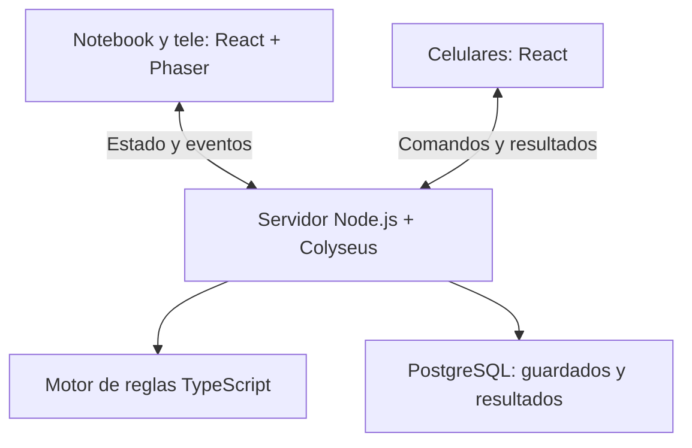

# RPG cooperativo web — Especificación técnica v0.1

Fecha: 14 de octubre de 2026.

Estado (16/10/2026): diseño técnico completo. La primera demo está implementada; [contratos y límites reales](docs/demo.md), [lockfile](pnpm-lock.yaml) y [evidencia](docs/estado-mvp.md) identifican el subconjunto comprobado. Los estados, comandos y funciones de etapas futuras de este documento siguen siendo objetivos, no capacidades de la demo.

Documento de reglas asociado: [RPG cooperativo — Reglas y guardado](rpg-cooperativo-reglas-v01.md), contenido v0.4. Las decisiones de jugabilidad se mantienen allí. Una definición técnica no debe convertir una propuesta de reglas pendiente en una regla confirmada.

## 1. Objetivo y requisitos

Desarrollar un juego web cooperativo de pixel art para dos a cuatro jugadores. Se juega principalmente en una reunión presencial con Internet: una notebook conectada al televisor muestra el tablero y cada participante usa su celular como control y ficha. El juego dirige automáticamente la aventura y controla a los enemigos.

Requisitos que condicionan la arquitectura:

- Una misma partida debe verse coherentemente en todas las pantallas.
- El servidor determina posiciones, turnos, tiradas, daño, percepción, botín y progreso.
- Los jugadores entran mediante código/QR, eligen su personaje y conservan su posición del lobby.
- La partida completa se puede recuperar mediante un código privado, sin crear cuentas.
- Los objetos son instancias únicas, incluso después de transferencias, reconexiones o recuperación de un guardado.
- Salir de una stage es individual: el jugador espera hasta que hayan cruzado todos los vivos. Los muertos avanzan con el grupo y conservan su condición hasta un altar.
- El movimiento precede a una sola acción. Una acción realizada cierra el movimiento; una habilidad fallida consume su uso.
- El daño usa d20 como base y un d6 para multiplicadores 1, 1,25 o 1,50. El crítico por sigilo sustituye el d6 por el multiplicador 1,50.

La demo permite crear campañas `LOCAL` (predeterminado) u `ONLINE`. En online, el anfitrión comparte la pantalla de la mesa por videollamada; cada participante usa su propio dispositivo como control a través de un origen HTTPS público que también transporta WSS. Ambos modos reutilizan servidor, reglas y conexión. Una vista de tablero propia en cada dispositivo sigue siendo una posibilidad futura, no parte de esta opción.

## 2. Stack de referencia

| Área | Selección | Responsabilidad |
| --- | --- | --- |
| Lenguaje | TypeScript en modo estricto | Tipos compartidos y validación estática del frontend, servidor y reglas. |
| Runtime del servidor | Node.js 24 LTS | Ejecutar salas, HTTP, reglas y persistencia. [T01] |
| Tablero | Phaser 4 | Escenas, tiles, sprites, cámara y animaciones 2D. La plantilla oficial consultada usa esta línea. [T02] |
| Interfaces | React 19 y CSS | Lobby, ficha móvil, inventario, mensajes y paneles sobre el tablero. [T02, T03] |
| Compilación web | Vite | Desarrollo y builds del frontend. [T04] |
| Multiplayer | Colyseus, línea 0.18 | Salas de ejecución, transporte y sincronización. SDK y paquetes de esquema compatibles con la misma línea. [T05] |
| Transporte | HTTPS para operaciones de sesión; WSS para la partida | Crear/recuperar sesiones y enviar intenciones, resultados y estado. |
| Mapas | Tiled, exportación JSON | Crear escenarios con capas, puertas, obstáculos y propiedades. [T09] |
| Validación | Zod 4 | Validar mensajes, contenido y guardados en tiempo de ejecución. [T14] |
| Base de datos | PostgreSQL, línea 18 de referencia | Metadatos, instantáneas JSONB y transacciones del guardado. [T10, T11] |
| Acceso SQL | node-postgres, paquete pg | Pool de conexiones, consultas parametrizadas y transacciones. [T12] |
| Migraciones | SQL versionado y registro de migraciones aplicadas | Evolución explícita del esquema, ejecutada con un script del servidor. |
| Repositorio | Git y GitHub | Código, revisión y versiones de contenido. |
| Paquetes | pnpm workspaces | Un repositorio con aplicaciones y módulos compartidos. [T13] |
| Pruebas de reglas e integración | Vitest | Comprobar invariantes, cálculos y flujos de servidor. [T15] |
| Pruebas web | Playwright | Tablero y varios controles en contextos separados. [T16] |
| Entorno reproducible | Docker y Docker Compose | Backend y PostgreSQL local; contenedor de backend para despliegue. [T17] |
| Integración continua | GitHub Actions | Tipos, validaciones, pruebas y builds. [T18] |

La primera integración debe verificar Node.js, Phaser, React, Vite y Colyseus conjuntamente. Se conserva una sola combinación comprobada en el lockfile. Una actualización mayor es un cambio de proyecto que requiere comprobar esa integración nuevamente.

Se propone usar CSS propio para la interfaz; las necesidades actuales no exigen una biblioteca adicional de componentes. El acceso a PostgreSQL se concentra en un módulo, con SQL explícito para mantener visibles las operaciones de guardado.

## 3. Arquitectura general

Un backend modular con un único proceso inicial. Dentro de ese proceso, cada partida tiene un responsable de ejecución y su cola de operaciones. Los clientes envían intenciones; el servidor publica los resultados confirmados.



Identidades distintas:

- `campaignId`: identifica la partida persistente.
- `runtimeRoomId`: identifica la sala de ejecución actual. Puede cambiar tras reiniciar el backend o recuperar una partida.
- `playerId`: identifica a un participante y su personaje durante toda la partida.
- `sessionId`: identifica una conexión o sesión del transporte. No sustituye a `playerId`.

Una sala lógica admite cuatro posiciones de jugadores y una pantalla compartida. El límite de conexiones debe contemplar esa pantalla y el proceso de reconexión; la pantalla no ocupa una posición de jugador. El mismo backend sirve las operaciones HTTP de sesión y las salas.

## 4. Responsabilidades y límites

| Componente | Responsabilidades |
| --- | --- |
| Tablero | Representar el mapa, entidades, salud, turnos, selección de objetivos, dados, narración y animaciones. |
| Control móvil | Mostrar ficha e inventario, acciones permitidas, movimiento restante, probabilidad de impacto y errores comprensibles. |
| Motor de reglas | Resolver movimiento, percepción, ataques, recursos, muerte, botín, alarmas, progresión y condiciones de transición. |
| Sala de ejecución | Asociar conexiones con jugadores, serializar comandos y coordinar reglas, guardado y publicación. |
| Persistencia | Confirmar instantáneas, recibos de comandos y eventos; recuperar la partida. |
| Contenido | Describir clases, enemigos, ítems, habilidades, mapas y narrativa mediante datos versionados. |

El motor de reglas no depende de React, Phaser, sockets ni conexiones SQL. Recibe estado y una operación válida, utiliza una fuente de aleatoriedad inyectada y devuelve el siguiente estado y sus resultados. Esto permite probarlo sin abrir un navegador.

La simulación de enemigos y la narración inicial se implementan con comportamiento y eventos programados. No se requiere un modelo generativo para dirigir la aventura.

## 5. Organización del repositorio

Estructura propuesta; estas rutas describen el futuro repositorio, no archivos de código ya creados:

| Ruta | Contenido |
| --- | --- |
| `apps/web` | Aplicación React, rutas de lobby, tablero y control; Phaser se carga al abrir el tablero. |
| `apps/server` | Arranque Node.js, rutas HTTP, salas Colyseus, persistencia y servicios de sesión. |
| `packages/core` | Estado de dominio, reglas, aleatoriedad y simulación de enemigos. |
| `packages/protocol` | Contratos de comandos, eventos, errores y validadores Zod. |
| `packages/content` | Manifiestos de clases, enemigos, habilidades, ítems y aventuras. |
| `assets` | Sprites, tilesets, mapas de origen y sonidos. |
| `infra` | Dockerfiles, Compose, configuración de despliegue y documentación operativa. |
| `docs` | Reglas, especificación técnica y decisiones posteriores. |

El frontend puede importar tipos y contratos compartidos. Los secretos, la persistencia y los resultados futuros de cofres o tiradas permanecen en módulos exclusivos del servidor. El paquete de protocolo no debe arrastrar dependencias SQL al navegador.

## 6. Interfaces y rutas

| Ruta web propuesta | Función |
| --- | --- |
| `/` | Crear, unirse o recuperar una partida. |
| `/lobby` | Nombre, posición y selección de clase. |
| `/board/:campaignId` | Pantalla compartida; requiere autorización de pantalla. |
| `/controller/:campaignId` | Ficha y controles del personaje asociado al dispositivo. |
| `/resume` | Introducir el código privado de continuación. |

Un identificador en la URL no concede por sí solo control sobre una partida. El servidor comprueba la asociación del dispositivo y su rol.

El control usa botones táctiles para cuatro direcciones y avanza una casilla por orden. Durante una orden pendiente se evita emitir otro movimiento ambiguo. Se puede mostrar una vista previa, pero la posición confirmada procede del servidor. Un botón permite finalizar el movimiento y pasar a elegir la acción cuando se cierre esa regla operativa.

Phaser conserva las instancias del escenario y actualiza las entidades desde la conexión. React presenta paneles y formularios. La unión entre ambos usa un adaptador/eventos tipados; al desmontar el tablero se liberan escena, listeners y recursos. El celular no necesita cargar Phaser para mostrar su ficha.

## 7. Estado de dominio

Separar el estado persistente, las vistas de red y la presentación local.

| Grupo de datos | Campos necesarios |
| --- | --- |
| Partida | Identificador, estado, versiones de reglas/contenido/guardado, revisión y progreso. |
| Turno | Ronda, fase, actor activo, orden del lobby, movimiento sorteado/restante, acción consumida y presupuesto de 20 segundos útiles con su pausa de animación. |
| Jugadores | Identidad estable, posición del lobby y asociación con personaje. |
| Personajes | Clase, salud, nivel, experiencia, estadísticas, efectos, recursos, inventario, equipo y posición. |
| Disponibilidad | Vivo/muerto; dentro de stage/esperando salida. La conexión online/offline es un dato separado. |
| Enemigos | Salud, posición, orientación, percepción, alarma, objetivo y estado de comportamiento. |
| Mundo | Stage, sala, puertas, obstáculos, cofres, altares y objetivos resueltos. |
| Objetos | Instancias por identificador y propietario/ubicación única; inventarios referencian esos identificadores. |
| Resolución | Comandos confirmados, resultados de tiradas y secuencia de eventos. |

Las clases de sincronización de Colyseus no son el formato definitivo del guardado. Implementar conversiones entre DTO persistente y estado de la sala. El servidor prepara vistas para tablero y controlador, usando filtros o mensajes dirigidos cuando corresponda. [T05, T07]

## 8. Máquina de turnos y avance

Fases de combate mínimas:

| Fase | Operaciones admitidas |
| --- | --- |
| `PLAYER_MOVEMENT` | Tirada de movimiento una vez y pasos cardinales válidos; pasar a acción según la regla de omisión. |
| `PLAYER_ACTION` | Una acción válida; se aplican costos aunque falle una habilidad. |
| `ENEMY_PHASE` | Operaciones internas de los enemigos; los controles no ejecutan acciones de personaje. |
| `STAGE_TRANSITION` | Aplicar recuperación de vivos, conservar muertos y cargar el siguiente escenario. |
| `PAUSED` | Reconectar y consultar; suspender nuevas operaciones de juego. |
| `WON` / `LOST` | Estado terminal, con política de historial/continuación pendiente. |

`WAITING_EXIT` es un estado del personaje, no una pausa global. Quien cruzó deja de participar en los turnos de la stage mientras los demás continúan.

El servidor gobierna el límite de 20 segundos útiles de cada turno de jugador. La cuenta se pausa durante las animaciones y no se pausa por desconexión del control. Al vencer, se serializa el avance con las demás operaciones de la campaña y se persiste antes de difundir el nuevo actor; desde el último jugador se resuelve la fase enemiga. Un ataque con D20 acertado y D6 pendiente se completa con una única tirada automática antes del avance. La cuenta visible pertenece exclusivamente al tablero compartido; los controles móviles reciben solo la disponibilidad normal de sus acciones.

Al comprobar la salida: primero se verifica si quedan personajes vivos. Si no queda ninguno, se aplica derrota; no se permite que una condición vacía de «todos los vivos cruzaron» avance una partida perdida. Si hay vivos y todos están esperando la salida, se realiza una única transición. Los muertos conservan su estado.

La estructura exacta de exploración, pérdida de sigilo y retorno a combate depende de las reglas aún pendientes. Se implementa como política explícita, sin asumir movimiento libre simultáneo ni introducir acciones adicionales.

## 9. Contratos de comandos

Cada comando contiene un identificador único, una revisión esperada y un payload validado. El servidor obtiene el actor desde su sesión autorizada; no confía en un `playerId` elegido libremente por el cliente.

Ejemplo conceptual de un movimiento:

```json
{
  "commandId": "9b9b9b1c-1601-47ab-89c1-16a050e8034f",
  "expectedRevision": 42,
  "type": "MOVE_STEP",
  "payload": { "direction": "RIGHT" }
}
```

| Comando propuesto | Validación principal |
| --- | --- |
| `ROLL_MOVEMENT` | Turno, fase y ausencia de una tirada previa. |
| `ATTACK` (demo actual) | Objetivo, habilidad, alcance, trayectoria, recurso y acción. Confirma impacto y D20; si acierta, deja `pendingAttack`. |
| `ROLL_ATTACK_D6` (demo actual) | Solo el actor del ataque pendiente, tras confirmación de la tirada anterior. Calcula daño y lo confirma una vez. |
| `MOVE_STEP` | Dirección cardinal, casilla libre, obstáculos y movimiento restante. |
| `FINISH_MOVEMENT` | Cierre irreversible de movimiento para ese turno. |
| `BASIC_ATTACK` | Acción disponible, objetivo, alcance y trayectoria. |
| `USE_SKILL` | Acción disponible, requisitos, objetivo y recursos de clase. |
| `USE_ITEM` | Propiedad, existencia, cantidad, requisitos y acción disponible. |
| `OPEN_CHEST` | Estado del cofre, distancia y costo definido por reglas. |
| `TRANSFER_ITEM` | Propietario actual, receptor y capacidad cuando se defina. |
| `CROSS_EXIT` | Personaje vivo y acceso válido a la salida. |
| `ACTIVATE_ALTAR` | Requisitos y costo de resurrección cuando se definan. |
| `END_TURN` | Opción de omisión según el reglamento final. |

Abrir cofres, transferir objetos y activar altares no se consideran acciones gratuitas por el hecho de figurar en esta tabla: sus costos siguen pendientes.

Errores tipados: `NOT_YOUR_TURN`, `WRONG_PHASE`, `STALE_REVISION`, `OUT_OF_RANGE`, `BLOCKED_PATH`, `NO_MOVEMENT`, `ACTION_USED`, `INSUFFICIENT_RESOURCE`, `ITEM_NOT_OWNED`, `CHEST_ALREADY_RESOLVED`, `PLAYER_DEAD` y `WAITING_EXIT`. El cliente los traduce a mensajes claros.

## 10. Resolución y sincronización

Flujo recomendado por operación:

1. Autenticar el rol y validar el contrato del comando.
2. Consultar si ese identificador ya fue confirmado; en ese caso devolver su resultado original.
3. Comprobar revisión, turno, fase y condiciones de juego.
4. Resolver sobre un estado provisional, incluyendo tiradas y efectos.
5. Confirmar en una transacción la nueva instantánea, el recibo del comando y los eventos.
6. Actualizar el estado autoritativo de la sala y publicar resultado/estado.

La publicación que confirma una operación ocurre después del guardado. Si falla la escritura, la operación no se presenta como confirmada y el juego informa que no puede continuar hasta recuperar persistencia.

El vencimiento del turno y el D6 automático siguen la misma coordinación, control de revisión y confirmación durable que los comandos de juego. Un reintento autorizado recupera su recibo original aunque el vencimiento haya avanzado la revisión; la conciliación de un guardado incierto no autoriza otra tirada. El tiempo útil y el estado de pausa se restauran al recuperar una campaña, sin reiniciar los 20 segundos.

Colyseus sincroniza las propiedades del estado modificadas desde el servidor. [T05] Añadir eventos explícitos para representar cada tirada, impacto, fallo o botín: varias operaciones pueden terminar en un mismo valor de estado y no deben perder su explicación visual.

Cada evento incluye `eventId`, secuencia, revisión y resultado suficiente para la presentación. El tablero evita reproducir dos veces el mismo evento. Una reconexión recupera el estado actual y solo los eventos pertinentes; no repite todo el combate anterior.

## 11. Tablero, mapas y recursos pixel art

Estado de recursos al 16 de octubre de 2026: consultar el [inventario de assets](docs/assets.md). Se recibieron animaciones de paladín, guerrero y mago, además de `assets/mapas/Scene_Overview.png`. El paladín es el conjunto completo de referencia; los inventarios distinguen faltantes, acciones por asignar e integración pendiente. No se recibieron capas separadas del escenario; la demo define su propio mapa lógico en packages/content. También se recibieron tres imágenes del maestro.

Tiled exporta mapas con capas visuales y propiedades de objetos/casillas. [T09] Un proceso de validación transforma ese contenido en un mapa lógico utilizable por el servidor y un manifiesto visual para Phaser.

| Propiedad lógica | Uso |
| --- | --- |
| `blocksMovement` | Rechazar la entrada a una casilla. |
| `blocksVision` | Interrumpir percepción y línea de visión según las reglas. |
| `partialCover` | Representación opcional, pendiente de definir en el reglamento. |
| `spawnType` / `spawnId` | Aparición de personajes, enemigos y objetos. |
| `exitId` / `destinationId` | Identificar conexiones de sala o salida de stage. |

Pared, hierba alta y pozo corresponden a las combinaciones de bloqueo acordadas. Una imagen decorativa no determina por sí sola la colisión.

La posición autoritativa utiliza coordenadas enteras de casilla. El tablero convierte casillas a píxeles y anima el desplazamiento. La distancia, la percepción orientada y los algoritmos de línea de visión se concentran en el motor; se probarán especialmente esquinas y obstáculos.

Al entrar en el encuentro, el tablero centra la cámara en el conjunto de jugadores presentes en sus casillas de aparición. El encuadre añade tres casillas visibles por eje respecto del encuadre efectivo anterior y, durante la exploración, mantiene el desplazamiento de cámara al acercarse el personaje activo al borde.

Definir antes de integrar arte: tamaño nativo del tile, tamaño de cada sprite, punto de apoyo, direcciones disponibles, nombres de animación, FPS y capas. El tamaño exacto sigue pendiente y debe acordarse con el equipo de arte.

Aplicar filtrado apropiado para pixel art y escala consistente. Mantener el tablero legible en 16:9, comprobar barras de vida y textos desde el sillón, y cargar los recursos de cada stage cuando corresponda. La primera validación de dispositivos usa una notebook con navegador; no depende del navegador integrado de un Smart TV.

## 12. Contenido y Dungeon Master automático

Definiciones versionadas para clases, enemigos, habilidades, objetos, tablas de botín, mapas, stages y eventos narrativos. Validar al construir y al cargar:

- Identificadores únicos y referencias existentes.
- Valores dentro de rangos admitidos.
- Tablas de probabilidades válidas.
- Puertas y puntos de aparición coherentes.
- Recursos gráficos referenciados disponibles.

La bolsa contiene cuatro espacios y el equipo cuatro ranuras: casco, guantes, pantalones y pechera. El equipo modifica estadísticas sin modificar apariencia. La arquera está excluida de la selección de esta demo.

Un objeto de inventario contiene un `itemInstanceId` único y un `definitionId` que apunta al catálogo. Cambiar de dueño no cambia la identidad. Un cofre guarda su resolución; el automático por sala limpia no vuelve a resolver cofres abiertos antes.

El personaje maligno del DM recibe eventos del juego y presenta diálogos asociados a inicio, detección, combate, muerte, botín y transición. Los enemigos toman decisiones programadas. La propagación de alarmas respeta la regla «un enemigo percibe a otro alertado»; la cadena y el comportamiento sin visión directa permanecen pendientes.

Las primeras tablas pueden tener datos provisionales para comprobar infraestructura, claramente identificados como contenido de prueba. Las estadísticas y habilidades definitivas siguen en standby.

## 13. Persistencia en PostgreSQL

Propuesta inicial: instantánea completa en JSONB más tablas relacionales pequeñas para identidades, resultados y acceso. PostgreSQL dispone de JSONB y transacciones; esta combinación permite conservar estado estructurado junto con metadatos consultables. [T10, T11]

| Tabla propuesta | Contenido y restricciones |
| --- | --- |
| `campaigns` | Identidad, estado, revisión, versiones, snapshot JSONB, hash del código privado y fechas. |
| `campaign_players` | Identidad estable, posición del lobby y credencial de recuperación del personaje; posición única dentro de la partida. |
| `command_receipts` | Actor, identificador del comando, hash del payload y resultado; unicidad por partida/actor/comando. |
| `campaign_events` | Eventos ordenados por secuencia y revisión; unicidad de secuencia por partida. |
| `schema_migrations` | Migraciones SQL aplicadas. |

Los objetos y su propietario se mantienen en una única estructura del snapshot. Los inventarios referencian objetos; no contienen copias independientes de la misma instancia. Validar ese invariante antes de confirmar transferencias y al recuperar.

Dentro de una transacción de node-postgres todas las consultas usan el mismo cliente obtenido del pool, con liberación en un bloque de cierre. [T12] Las consultas reciben parámetros; no se interpolan datos del usuario dentro del SQL.

Un único proceso inicial y una única cola por partida simplifican el ownership. Además, la actualización verifica la revisión persistida. Recuperar el mismo código dos veces reutiliza una sala activa o rechaza la duplicación: no crea dos partidas que escriban sobre el mismo guardado.

## 14. Guardado, recuperación y versiones

Guardar cada cambio de juego confirmado: tirada de movimiento, paso, ataque, fallo con recurso consumido, apertura de cofre, transferencia, muerte, salida y transición. Un botón «guardar y salir» confirma el último estado ya persistido y pausa según permisos definidos.

El snapshot conserva todos los datos del reglamento, especialmente:

- Tirada de movimiento resuelta y casillas restantes.
- Multiplicador del d6 o crítico de sigilo ya aplicado.
- Personajes muertos y jugadores esperando salida.
- Cofres resueltos, monstruos generados y propiedad del botín.
- Salud, recursos, nivel, equipo y estado de enemigos.
- Actor y fase exactos, progreso y alarmas.

Al cargar se validan `saveSchemaVersion`, `rulesVersion` y `contentVersion`. No aplicar silenciosamente nuevas estadísticas a una partida anterior. Mantener el contenido compatible disponible o ejecutar una migración probada.

Una escritura persistida seguida de una caída antes del aviso no duplica la acción: el reintento encuentra su recibo original. Un doble toque tampoco genera una segunda tirada. El mismo identificador con otro payload se rechaza.

El backup de la base de datos es independiente del autosave y necesita una prueba real de restauración antes de usar partidas importantes.

## 15. Código privado e identidad de los jugadores

Se recomienda distinguir tres funciones:

| Credencial | Función |
| --- | --- |
| Código corto de lobby | Incorporarse a la reunión; puede mostrarse en el tablero. |
| Código privado de recuperación | Reabrir la partida guardada sin cuentas. |
| Credencial de personaje | Recuperar el mismo slot y personaje desde su celular. |

El código de recuperación se genera con aleatoriedad apropiada y se guarda mediante hash para validarlo. Longitud, expiración y rotación deben definirse al implementar. Nunca usar exclusivamente un identificador consecutivo de partida como código privado.

Al recuperar la campaña, el coordinador entra con el código y se reasocian los celulares a los personajes existentes. La forma de recuperar un personaje en otro teléfono y los permisos del coordinador deben cerrarse; no se crean nuevos personajes ni se reordena el lobby automáticamente.

Las sesiones tienen roles: `DISPLAY`, `PLAYER` y `COORDINATOR`. El tablero no ejecuta ataques y el jugador no puede controlar otro personaje. Las credenciales y resultados futuros permanecen fuera del estado público. El código privado no se muestra en el QR público de entrada.

## 16. Reconexión y suspensión móvil

Colyseus ofrece mecanismos de reconexión y recuperación de estado. [T06] Añadir la política de juego, que el framework no decide:

- Bloquear controles mientras el celular esté desconectado.
- Recuperar siempre el mismo `playerId` y posición del lobby.
- Rechazar operaciones pendientes que ya no correspondan al turno/revisión actual.
- Mantener el personaje y su inventario al terminar una conexión.
- Recuperar tras recargar, bloquear el teléfono o cambiar de aplicación.
- Mostrar en el tablero quién perdió conexión.

Propuesta inicial: pausar el avance si se pierde al jugador activo, permitir su reconexión y evitar que el enemigo actúe solo por una caída de red. El tiempo de espera y la posibilidad de omitir ese turno deben confirmarse.

Si se desconecta la pantalla compartida, los datos sobreviven y se permite reconectarla. Se recomienda pausar la partida presencial para evitar decisiones sin tablero. Si se desconectan todos, se guarda y se suspende la sala; el código permite reconstruirla después. El token del transporte sirve para reconexión corta; la recuperación durable depende del sistema de guardado.

## 17. Operaciones HTTP

Rutas orientativas para el servicio de sesión; no constituyen una API ya implementada:

| Método y ruta | Función |
| --- | --- |
| `POST /api/campaigns` | Crear partida y emitir credenciales iniciales. |
| `POST /api/lobbies/join` | Validar código de lobby y reservar posición. |
| `POST /api/campaigns/recover` | Validar código privado y recuperar campaña. |
| `POST /api/campaigns/:id/reclaim-player` | Recuperar personaje mediante el mecanismo autorizado. |
| `GET /health/live` | Comprobar proceso vivo. |
| `GET /health/ready` | Comprobar que puede aceptar trabajo y acceder a persistencia. |

Los comandos de juego circulan por la sala WSS. Pausa y cierre pueden ser mensajes de coordinador usando el mismo control de permisos. No exponer una ruta que permita subir un snapshot arbitrario desde el celular.

## 18. Alojamiento y despliegue

Topología recomendada:

- Frontend Vite compilado a recursos estáticos, alojado en Vercel como opción de referencia.
- Backend Node.js/Colyseus en un contenedor o servicio con proceso persistente y soporte WebSocket.
- PostgreSQL con almacenamiento durable y backups.
- Backend y base de datos próximos entre sí y una región con latencia razonable para los jugadores.

El proveedor concreto del backend, plan, región y presupuesto siguen pendientes. Colyseus documenta despliegue propio y opciones gestionadas. [T08] Elegirlos tras comprobar el prototipo y sus requisitos; no se fija aquí un precio ni se contrata infraestructura.

A fecha de consulta, Vercel tiene soporte WebSocket en beta, con duración de funciones y necesidad de estado externo para reconexiones entre instancias. [T19] La recomendación de un proceso persistente para Colyseus se basa en el ownership de salas y estado en memoria que propone este proyecto; no en afirmar que Vercel carece de WebSockets.

Producción requiere HTTPS/WSS, orígenes permitidos, secretos solo en backend, migraciones antes de aceptar campañas y una estrategia de reinicio: dejar de admitir nuevas salas, confirmar operaciones pendientes y permitir recuperación desde PostgreSQL. La gestión exacta de partidas durante un despliegue debe probarse.

## 19. Entorno y configuración

Variables de referencia:

| Variable | Uso |
| --- | --- |
| `NODE_ENV` | Entorno del servidor. |
| `PORT` | Puerto HTTP/WebSocket. |
| `DATABASE_URL` | Conexión privada a PostgreSQL. |
| `APP_ORIGIN` | Origen permitido del frontend. |
| `SESSION_SECRET` | Firma/validación de sesiones cuando se defina el formato. |
| `VITE_API_BASE_URL` | Dirección pública de HTTP del backend. |
| `VITE_GAME_SERVER_URL` | Dirección pública para conectar la sala. |

Los valores `VITE_*` son públicos; no contienen secretos. Documentar `.env.example` en el repositorio futuro con nombres y ejemplos ficticios. Docker Compose inicia backend y base de datos local; el frontend puede usar Vite durante desarrollo. Las migraciones y el contenido de prueba se ejecutan de manera explícita.

Comandos de raíz previstos: `pnpm dev`, `pnpm build`, `pnpm typecheck`, `pnpm test`, `pnpm test:e2e`, `pnpm db:migrate` y `pnpm content:validate`. El primer scaffold deberá implementarlos; todavía no están disponibles.

## 20. Rendimiento y operación

El juego resuelve operaciones discretas; no necesita enviar posiciones de todos los personajes a 60 Hz. Phaser puede animar localmente mientras el servidor actualiza casillas y resultados. La frecuencia de parches se ajusta tras medir; las acciones importantes cuentan con confirmación individual.

Objetivos de aceptación iniciales, que deben medirse en los dispositivos de prueba:

- Controles legibles y utilizables en celulares Android e iOS.
- Tablero fluido en la notebook elegida; ajustar resolución y efectos antes de comprometer un mínimo de FPS.
- Respuesta habitual al toque suficientemente rápida para mover casillas; registrar percentiles de latencia en vez de asumir tiempos por proveedor.
- Reconexión y recuperación sin pérdida de operaciones confirmadas.
- Sesiones con cuatro jugadores y tablero durante toda una aventura de prueba.

Logs estructurados: identificador de campaña, revisión, tipo de comando, duración, rechazos y fallos de persistencia. No registrar códigos privados ni credenciales. Medir conexiones, salas activas, operaciones por segundo y tamaño/tiempo de snapshots. Reglas e integridad del inventario se validan en servidor.

## 21. Plan de verificación

| Área | Casos que deben comprobarse |
| --- | --- |
| Turnos | Orden del lobby, una acción, movimiento cerrado después de actuar, habilidad fallida consumida. |
| Movimiento | Cuatro direcciones, d6 sorteado una vez, ocupación por aliados y cada tipo de obstáculo. |
| Impacto y daño | Heridas, distancia, evasión, multiplicadores del d6, defensa plana y ausencia de efecto especial por sacar 20. |
| Sigilo | Ataque inicial con factor 1,50 y ninguna tirada adicional del d6; percepción/alarma según reglas cerradas. |
| Botín | Cofre resuelto una vez, resultado malo antes de limpiar y botín seguro al limpiar; transferencia sin duplicación. |
| Transición | Espera individual, todos los vivos cruzaron, muertos conservados y recuperación de vida aplicada una sola vez. |
| Derrota | Ningún vivo implica fin de partida; no dispara una transición por condición vacía. |
| Persistencia | Recuperar desde backend reiniciado; conservar fase, dados, muertes, cofres y espera de salida. |
| Reintentos | Doble toque y reconexión tras confirmar SQL sin recibir aviso: una sola acción y un solo resultado. |
| Interfaces | Una pantalla de tablero y dos/cuatro contextos móviles; bloqueo y recuperación de conexión. |

Vitest cubre el motor y los servicios; la integración de persistencia usa PostgreSQL de prueba. Playwright comprueba flujos web separados. [T15, T16] Su emulación se complementa con teléfonos físicos, especialmente suspensión y reconexión en iOS.

GitHub Actions ejecuta tipos, validación de contenido, pruebas y builds en cada cambio relevante. Las pruebas E2E de persistencia requieren backend y base de datos reales en el entorno de prueba. No se afirma que estos casos hayan sido ejecutados: son el criterio de aceptación para la implementación.

## 22. Orden de implementación

1. **Integración técnica:** crear workspace, fijar versiones y conectar tablero/control a una sala. Probar que PostgreSQL conserva una campaña al reiniciar el backend.
2. **Turno completo:** movimiento, acción, enemigos y actualización coherente de las pantallas, con contenido de prueba.
3. **Reglas de combate:** impacto, daño, defensa, percepción, alarmas y sigilo según decisiones cerradas.
4. **Exploración y botín:** objetos únicos, cofres y transferencias; costos todavía pendientes deben resolverse antes de cerrar esta etapa.
5. **Progreso:** salida individual, siguiente stage, recuperación, muerte y altares.
6. **Recuperación usable:** código privado, asociación de celulares, pausa y pruebas de caída/reinicio. La persistencia existe desde la etapa 1; aquí se completa su experiencia de usuario.
7. **Aventura compartible:** arte definitivo, narrativa, balance, compatibilidad móvil y despliegue.

Cada etapa entrega un flujo verificable. Los valores de clases e ítems se completan en sus tablas de contenido, sin rehacer el transporte ni el guardado.

## 23. Decisiones pendientes y mantenimiento documental

| Pendiente | Qué afecta |
| --- | --- |
| Clases, habilidades, estadísticas, inventario y tablas de botín | Catálogo y balance; permanecen en standby. |
| Redondeo y mínimo de daño | Resolución exacta del ataque. |
| Métrica de distancia, cobertura y visión orientada | Motor del mapa y percepción. |
| Exploración y alarma sin visión directa | Máquina de fases y enemigos. |
| Costos de cofres, transferencias y altares | Validación de acciones. |
| Reparto del botín y estado de espera tras cruzar | Propiedad y disponibilidad de personajes. |
| Política de desconexión y permisos de coordinador | Pausa y recuperación. |
| Recuperación de personaje en otro teléfono | Identidad sin cuentas. |
| Proveedor de backend, región, dominio y backups | Operación y presupuesto. |
| Parches exactos de dependencias | Lockfile tras la integración inicial. |

Mantener este documento y el reglamento como archivos de referencia compartidos. Una nueva decisión de juego actualiza las reglas; un cambio de contrato, estado o persistencia actualiza además la especificación técnica. Las decisiones de infraestructura se registran con fecha y motivo. Esta versión técnica no altera las reglas pendientes.

## 24. Documentación oficial consultada

Consulta: 14 de octubre de 2026. Las fuentes acreditan capacidades de las herramientas; la arquitectura, los contratos, las tablas y el plan son propuestas específicas para este proyecto.

| Ref. | Fuente |
| --- | --- |
| T01 | [Node.js — líneas y estado de releases](https://nodejs.org/en/about/previous-releases) |
| T02 | [Plantilla oficial Phaser, React y TypeScript](https://github.com/phaserjs/template-react-ts) y [dependencias de la plantilla](https://github.com/phaserjs/template-react-ts/blob/main/package.json) |
| T03 | [React — documentación](https://react.dev/learn) |
| T04 | [Vite — guía](https://vite.dev/guide/) |
| T05 | [Colyseus — sincronización de estado](https://docs.colyseus.io/state) |
| T06 | [Colyseus — reconexión](https://docs.colyseus.io/room/reconnection) |
| T07 | [Colyseus — vistas por cliente](https://docs.colyseus.io/state/view) |
| T08 | [Colyseus — despliegue](https://docs.colyseus.io/deployment) |
| T09 | [Tiled — propiedades personalizadas](https://doc.mapeditor.org/en/stable/manual/custom-properties/) |
| T10 | [PostgreSQL — JSON y JSONB](https://www.postgresql.org/docs/current/datatype-json.html) |
| T11 | [PostgreSQL — transacciones](https://www.postgresql.org/docs/current/tutorial-transactions.html) |
| T12 | [node-postgres — transacciones](https://node-postgres.com/features/transactions) y [pool de conexiones](https://node-postgres.com/features/pooling) |
| T13 | [pnpm — workspaces](https://pnpm.io/workspaces) |
| T14 | [Zod — validación](https://zod.dev/) |
| T15 | [Vitest — guía](https://vitest.dev/guide/) |
| T16 | [Playwright — documentación](https://playwright.dev/docs/intro) |
| T17 | [Docker Compose — documentación](https://docs.docker.com/compose/) |
| T18 | [GitHub Actions — documentación](https://docs.github.com/en/actions/get-started/understand-github-actions) |
| T19 | [Vercel — WebSockets y límites de ejecución](https://vercel.com/docs/functions/websockets) |
